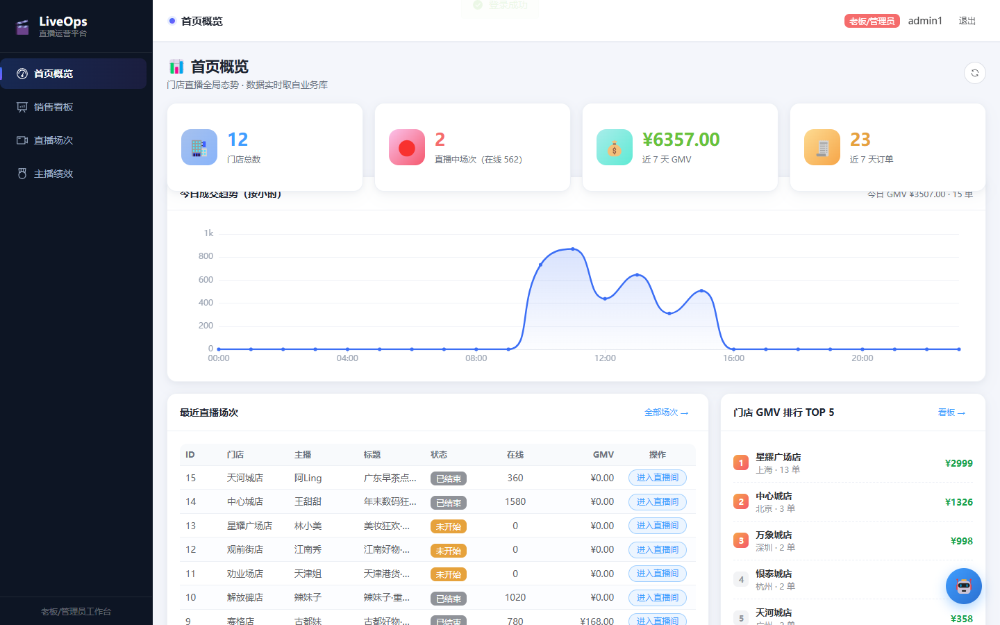
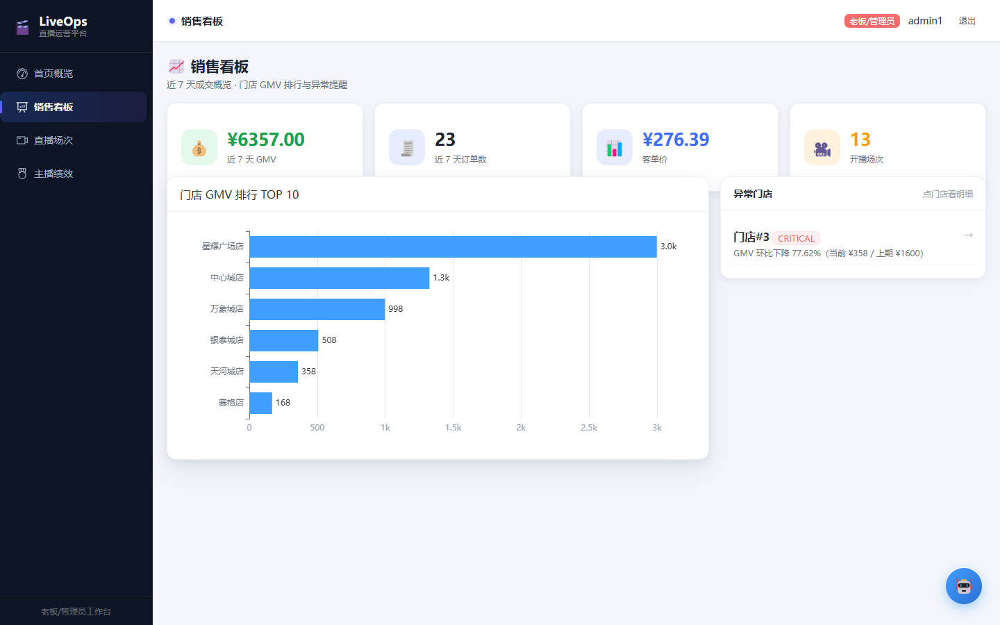
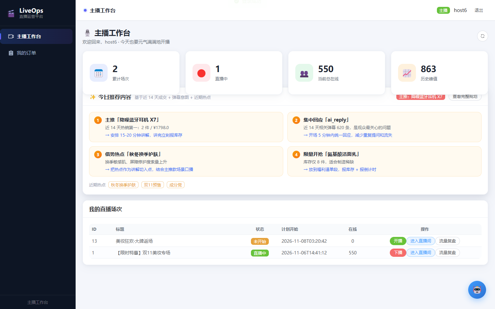
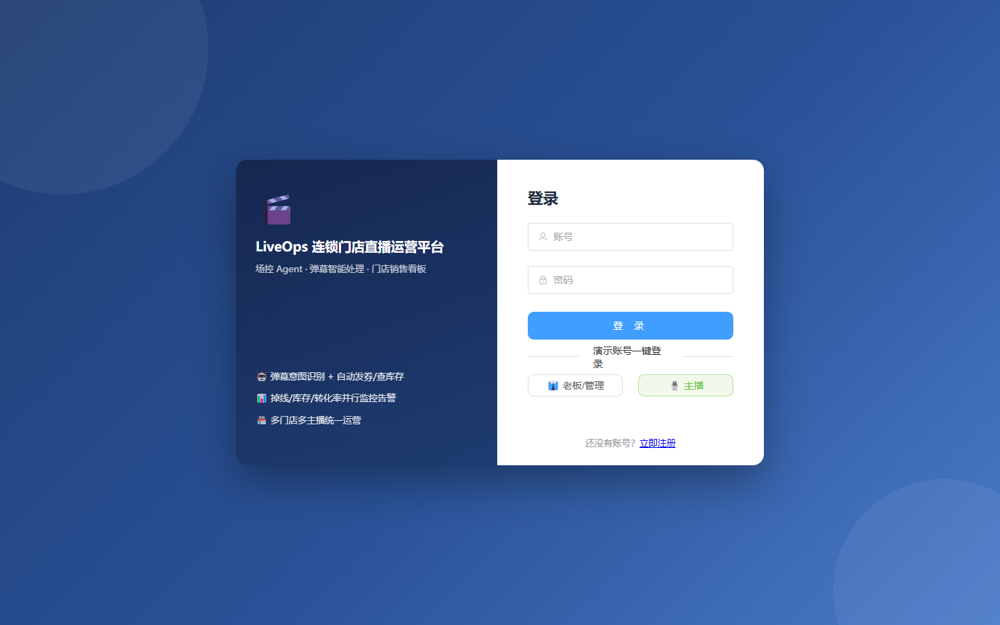

# LiveOps · 连锁门店直播运营平台

一套可直接演示的「老板端 + 主播端」直播运营系统：门店/商品/直播/优惠券/订单/销售看板全链路，加上弹幕实时处理 Agent（意图识别 → 自动回复/发券/查库存/转人工）与并行监控线（掉线、库存、转化异常自动告警）。

前后端 + MySQL/Redis/PostgreSQL 全部容器化，**一条命令启动**，无 LLM Key 也能完整演示。

---

## 界面预览

| 老板端 · 首页概览 | 老板端 · 销售看板 |
| --- | --- |
|  |  |

| 主播端 · 工作台 | 登录页 |
| --- | --- |
|  |  |

---

## 快速开始

### 方式一：一键脚本（推荐）

```bash
# macOS / Linux / WSL
./start.sh
```

```powershell
# Windows PowerShell
.\start.ps1
```

脚本会自动：检查 `.env` → 检查 Docker → 构建并启动 5 个容器 → 等待健康检查通过 → 打印访问地址。

### 方式二：手动命令

```bash
cp .env.example .env          # 可选：填写 LLM_API_KEY 开启 AI 话术，留空自动降级
docker compose --profile ui up -d --build
```

### 方式三：离线镜像包（目标机器无外网）

在有网机器上导出：

```bash
./export-offline.sh           # 生成 liveops-offline-YYYYMMDD.tar.gz（约 1~2 GB）
```

把压缩包 + 项目目录拷给对方，对方执行：

```bash
./import-offline.sh liveops-offline-YYYYMMDD.tar.gz
```

Windows 使用同名 `.ps1` 脚本即可。

---

## 访问地址与账号

| 项目 | 地址 |
| --- | --- |
| 老板端 / 主播端 | http://localhost:8088 |
| 健康检查 | http://localhost:8088/api/health |
| 就绪检查 | http://localhost:8088/api/health/ready |

演示账号（密码统一 `123456`）：

| 用户名 | 角色 | 说明 |
| --- | --- | --- |
| `admin1` | ADMIN | 老板 / 管理员，看全部门店与主播 |
| `host6` | HOST | 主播，只能看到自己的场次与订单 |
| `op1` ~ `op12` | OPERATOR | 场控坐席 |
| `customer1` ~ `customer5` | CUSTOMER | 顾客端账号 |

> 主播端已做数据隔离：HOST 登录后接口层强制按自己的 `staff_id` 过滤场次、订单与主播排行。

---

## 功能地图

### 老板端（结果导向，一眼看清）

- **首页概览**：门店数、直播中场次与在线人数、近 7 天 GMV / 订单、今日成交按小时趋势
- **销售看板**：近 7 天汇总、门店 GMV 排行、异常门店预警（环比下滑 > 30%），可下钻查看门店与最近场次
- **直播场次**：场次列表、状态流转、场次实时看板
- **主播绩效**：主播 GMV / 场次 / 转化率排行
- **订单**：订单列表、订单详情（金额、优惠、支付时间、商品明细）

### 主播端（开播即用）

- **工作台**：累计场次、当前在线、历史峰值、今日推荐内容（主推 / 集中回应 / 借势热点 / 限量开抢）
- **直播间**：弹幕流 + AI 自动回复 + 一键转人工、直播节奏计时与阶段提示、实时 KPI
- **流量复盘**：本场流量与成交曲线
- **我的订单**：只含本主播场次订单

### 场控 Agent

```
弹幕流入 → Redis Streams 削峰 → 意图分类（LLM / jieba 规则降级）
  ├ FAQ      → RAG / 商品库自动回复
  ├ 要券     → 自动发券（超预算转人工）
  ├ 库存     → 实时查库存回复
  ├ 售后/投诉 → 转人工待办
  └ 广告刷屏 → 静默过滤
并行监控线（每 30s）：viewer_drop / stock_alert / low_conversion / peak_focus
```

演示模式（`DEMO_MODE=true`）下还会：

- 每 15~40s 自动注入真实感弹幕，走完整 Agent 链路并回写 AI 回复
- 在线人数做 ±2%~3% 平滑游走，避免数字突兀跳变
- 每 10 分钟把「直播中场次」和「今日订单」的时间推到当前时刻，长时间演示数据也不会变旧

---

## 核心接口

前缀 `/api/v1`，除登录/注册外均需 `Authorization: Bearer <access_token>`。

| 方法 | 路径 | 说明 |
| --- | --- | --- |
| POST | `/auth/login` | 登录，返回 `access_token` |
| GET | `/auth/me` | 当前用户信息 |
| GET | `/dashboard/home` | 首页概览 |
| GET | `/dashboard/intraday` | 今日按小时成交趋势 |
| GET | `/dashboard/sales` | 销售汇总（含异常门店） |
| GET | `/dashboard/store-rank` | 门店 GMV 排行 |
| GET | `/live-sessions` | 直播场次列表（HOST 自动收敛） |
| PUT | `/live-sessions/{id}/status` | 开播 / 下播 |
| GET | `/live-sessions/{id}/dashboard` | 场次实时看板 |
| GET | `/orders` | 订单列表（HOST 自动收敛） |
| GET | `/orders/{id}` | 订单详情 |
| POST | `/live/{session_id}/danmaku` | 投递弹幕 |
| GET | `/live/{session_id}/danmaku` | 拉取弹幕与 AI 回复 |
| POST | `/live/{session_id}/danmaku/{msg_id}/manual-reply` | 人工回复 |
| WS | `/live/{session_id}/stream` | 实时弹幕 + Agent 决策推送 |
| GET | `/pacing/{session_id}` | 直播节奏状态 |
| GET | `/analytics/hosts/rank` | 主播绩效排行 |

---

## 8 分钟演示动线

1. `admin1` 登录 → 首页看今日趋势与在线人数
2. 进入「销售看板」→ 点异常门店卡片 → 下钻门店详情
3. 进入「直播场次」→ living 场次「进入直播间」
4. 主播端看弹幕自动回复 → 点一条转人工 → 亲自回复
5. 看右栏监控事件与节奏提示
6. 下播 → 自动进入本场复盘
7. 换 `host6` 登录 → 工作台只看到自己的 2 场直播与自己的订单

---

## 降级与容错

| 场景 | 行为 |
| --- | --- |
| 未配置 `LLM_API_KEY` | 意图分类走 jieba 关键词规则，回复走模板话术，主链路完整可演示 |
| LLM 调用失败 / 超时 | 自动回落到模板话术，不阻断弹幕回复 |
| Milvus 未启动 | 跳过 RAG 检索，FAQ 使用商品描述 |
| 后端重启 | 容器内定时任务自动恢复，演示数据时间自动对齐当前时刻 |

---

## 测试与 CI

```bash
cd backend
pip install -r requirements.txt pytest
pytest -q
```

GitHub Actions（`.github/workflows/ci.yml`）：

- `backend-tests`：安装依赖并执行 pytest
- `docker-smoke`：构建整套容器 → 等待健康检查 → 校验登录与 7 个核心接口均返回 200

---

## 目录结构

```
liveops/
├── backend/                 # FastAPI + SQLAlchemy + APScheduler
│   ├── app/
│   │   ├── api/routes/      # 业务接口
│   │   ├── agent/           # 意图分类 / Agent 图 / 话术
│   │   ├── monitor/         # 定时巡检 + 演示数据维护
│   │   ├── models/          # ORM 模型
│   │   └── core/            # 配置 / 数据库 / 鉴权 / 依赖
│   └── tests/               # pytest 用例
├── frontend/                # Vue 3 + TypeScript + Element Plus + ECharts
├── init/mysql/              # 建表与种子数据（含异常门店演示数据）
├── docs/screenshots/        # README 截图
├── docker-compose.yml
├── start.sh / start.ps1
└── export-offline.sh / import-offline.sh
```

---

## 常见问题

**端口 8088 被占用？** 修改 `docker-compose.yml` 中 frontend 的 `ports`，例如 `"8090:80"`。

**首次启动较慢？** 需要拉取 MySQL/Redis/PostgreSQL/Python/Node 基础镜像，后续启动为秒级。

**改了代码不生效？** 代码是打进镜像的，需要 `docker compose --profile ui up -d --build`；一键脚本已包含 `--build`。

**想清空数据重来？** `docker compose --profile ui down -v` 后重新启动即可。
